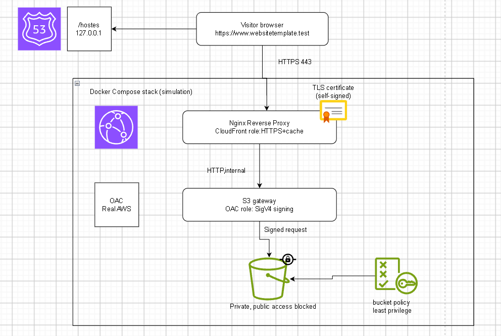

# Secure Static Web Hosting & CDN Deployment (AWS, emulated with LocalStack)



> Internship Task 2 at **Progree**: deploy a globally available static website from a **private object storage bucket**, restricted by a **JSON policy**, reachable through a **custom domain**, and served by a **CDN cache layer with SSL/TLS**.
>
> **Important:** CloudFront is not available in LocalStack Community (nor in the other free emulator I tested). The CDN layer and the Origin Access Control (OAC) are therefore **simulated** with Nginx and an S3 gateway. The real AWS configuration files (OAC, CloudFront distribution, bucket policy, ACM, Route 53 alias) are provided in [`aws-real/`](#8-real-aws-deployment-prepared-not-executed) and are **prepared but not executed**.

---

## Table of contents

1. [What this project does](#1-what-this-project-does)
2. [Architecture and request flow](#2-architecture-and-request-flow)
3. [Real AWS vs this simulation](#3-real-aws-vs-this-simulation)
4. [Repository structure](#4-repository-structure)
5. [Prerequisites](#5-prerequisites)
6. [Step-by-step build](#6-step-by-step-build)
7. [Tests](#7-tests)
8. [Real AWS deployment (prepared, not executed)](#8-real-aws-deployment-prepared-not-executed)
9. [How HTTPS works here](#9-how-https-works-here)
10. [Troubleshooting](#10-troubleshooting)
11. [Limitations](#11-limitations)
12. [Cleanup](#12-cleanup)
13. [Security notes](#13-security-notes)

---

## 1. What this project does

| Requirement of the task | How it is met |
|---|---|
| Isolated object storage container | S3 bucket `website-template` on LocalStack, with **Block Public Access** enabled |
| Granular access restriction with a JSON policy | Bucket policy allowing only `s3:GetObject` from one CloudFront distribution (`aws-real/bucket-policy.json`) |
| Custom domain mapping | Route 53 hosted zone and record (LocalStack) plus the Windows `hosts` file so the browser resolves the name |
| CDN cache layer | Nginx reverse proxy with `proxy_cache` (`X-Cache-Status: MISS` then `HIT`) |
| SSL encryption | TLS termination in Nginx with an OpenSSL self-signed certificate, and HTTP to HTTPS redirect |
| Private bucket reachable only by the CDN | S3 gateway signs every request with AWS SigV4 (the OAC role), and is not exposed to the host |

## 2. Architecture and request flow

```
Browser ──(name lookup)──► Route 53 / hosts file  →  127.0.0.1
   │
   │ https://www.websitetemplate.test   (port 443)
   ▼
nginx-front   "CloudFront role": TLS termination, 301 redirect, cache
   │  HTTP, internal Docker network
   ▼
s3-gateway    "OAC role": signs the request with SigV4
   │  signed request
   ▼
LocalStack S3  private bucket "website-template"
```

Step by step for one visit to `/`:

1. The browser resolves `www.websitetemplate.test` to `127.0.0.1` (hosts file).
2. It connects to Nginx on port 443 and the TLS handshake takes place (certificate from `nginx/certs`).
3. Nginx rewrites `/` to `/index.html` (the *Default root object* of CloudFront).
4. If the object is in the cache, Nginx answers immediately (`HIT`). Otherwise it forwards the request to `s3-gateway` (`MISS`).
5. The gateway computes the SigV4 signature and requests the object from the private bucket.
6. The response goes back through Nginx, which stores it for 10 minutes.

## 3. Real AWS vs this simulation

| Role | Real AWS | This project |
|---|---|---|
| Object storage | Amazon S3 | S3 on LocalStack 3.8.1 (Community) |
| CDN, cache, HTTPS, redirect | Amazon CloudFront | Nginx reverse proxy (`nginx-front`) |
| Origin Access Control (signed requests) | CloudFront OAC (SigV4) | `nginx-s3-gateway` (SigV4) |
| Certificate | AWS Certificate Manager (private key never exportable) | OpenSSL self-signed certificate (ACM request also made on LocalStack, for documentation) |
| DNS | Route 53 alias to CloudFront | Route 53 on LocalStack (documentation) plus the `hosts` file (real resolution) |
| Access policy | Bucket policy with `AWS:SourceArn` condition | Same JSON, stored by LocalStack, not strictly enforced |

## 4. Repository structure

```
.
├── README.md
├── docs/
│   └── architecture.png
├── docker-compose.yaml        # LocalStack + s3-gateway + nginx-front
├── .env.example               # copy to .env
├── .gitignore
├── setup.ps1                  # rebuilds the whole LocalStack state
├── site/                      # your static site (index.html at the root)
├── nginx/
│   ├── nginx.conf
│   └── certs/                 # generated locally, git-ignored
├── route53/
│   └── record.json
└── aws-real/                  # prepared for a real AWS account, not executed
    ├── oac.json
    ├── distribution.json
    ├── bucket-policy.json
    └── alias-record.json
```

## 5. Prerequisites

| Tool | Check with | Notes |
|---|---|---|
| Docker Desktop (running) | `docker --version` | The whale icon must be visible |
| Docker Compose v2 | `docker compose version` | Included in Docker Desktop |
| Python and pip | `python --version` and `pip --version` | Needed for `awslocal` |
| `awslocal` | `awslocal --version` | `pip install awscli-local` (deprecated but functional; `lstk aws` is the replacement) |
| Git | `git --version` | |
| PowerShell | | All commands below are for **Windows PowerShell** |

Commands use `curl.exe` (not `curl`): in PowerShell `curl` is an alias of another command.

## 6. Step-by-step build

All commands are run from the project root.

### Step 1. Environment variables

```powershell
Copy-Item .env.example .env
```

`.env.example`:

```
BUCKET_NAME=website-template
AWS_ACCESS_KEY_ID=test
AWS_SECRET_ACCESS_KEY=test
AWS_REGION=us-east-1
```

Docker Compose reads `.env` automatically. LocalStack accepts any credentials, so `test` is used. **Never put real AWS keys in this file.**

### Step 2. Put your site in `site/`

`index.html` must be at the **root** of `site/` (not in a sub-folder), otherwise the default page is not found. For a framework project, copy the build output (`dist/` or `build/`).

### Step 3. Generate the TLS certificate (replaces ACM)

```powershell
mkdir nginx\certs
docker run --rm -v "${PWD}/nginx/certs:/certs" alpine/openssl req -x509 -nodes -newkey rsa:2048 -days 365 -keyout /certs/privkey.pem -out /certs/fullchain.pem -subj "/CN=www.websitetemplate.test" -addext "subjectAltName=DNS:www.websitetemplate.test"
```

| Option | Meaning |
|---|---|
| `req -x509` | Creates a **self-signed** certificate (no certificate authority) |
| `-nodes` | No passphrase on the private key (Nginx must read it at start-up) |
| `-newkey rsa:2048` | Generates a new 2048-bit RSA key pair |
| `-days 365` | Validity of one year |
| `-keyout` / `-out` | Private key file / certificate file |
| `-subj "/CN=..."` | Domain name certified (Common Name) |
| `-addext "subjectAltName=..."` | Subject Alternative Name, required by modern browsers |

Verify the content (no brackets, no `https://` in the name):

```powershell
docker run --rm -v "${PWD}/nginx/certs:/certs" alpine/openssl x509 -in /certs/fullchain.pem -noout -subject -ext subjectAltName -dates
```

Why not reuse the ACM certificate? ACM never exposes the private key, so it can only be attached to AWS services (CloudFront, load balancers). Nginx needs the key file.

### Step 4. Nginx configuration

`nginx/nginx.conf`:

```nginx
events {}

http {
    proxy_cache_path /var/cache/nginx levels=1:2 keys_zone=cdn_cache:10m max_size=100m inactive=60m;

    server {
        listen 80;
        server_name www.websitetemplate.test;
        return 301 https://$host$request_uri;
    }

    server {
        listen 443 ssl;
        server_name www.websitetemplate.test;

        ssl_certificate     /etc/nginx/certs/fullchain.pem;
        ssl_certificate_key /etc/nginx/certs/privkey.pem;

        location / {
            rewrite ^/$ /index.html;

            proxy_pass http://s3-gateway;

            proxy_cache cdn_cache;
            proxy_cache_valid 200 10m;
            add_header X-Cache-Status $upstream_cache_status;
        }
    }
}
```

| Directive | Role | CloudFront equivalent |
|---|---|---|
| `proxy_cache_path` | Defines the cache store (100 MB max, entries dropped after 60 min unused) | Edge cache |
| `return 301 https://...` | Redirects HTTP to HTTPS | Viewer protocol policy: Redirect HTTP to HTTPS |
| `listen 443 ssl` and `ssl_certificate*` | TLS termination | Custom SSL certificate |
| `rewrite ^/$ /index.html` | Serves `index.html` for `/` | Default root object |
| `proxy_pass http://s3-gateway` | Forwards to the origin by its Docker service name | Origin |
| `proxy_cache_valid 200 10m` | Keeps successful responses 10 minutes | TTL |
| `add_header X-Cache-Status` | Exposes `MISS` / `HIT` | `X-Cache` header |

`nginx.conf` must be a **file**. If it does not exist when you start Compose, Docker creates a **folder** with that name and the mount fails (see [Troubleshooting](#10-troubleshooting)).

### Step 5. Docker Compose

`docker-compose.yaml`:

```yaml
services:

  localstack:
    image: localstack/localstack:3.8.1
    container_name: localstack
    ports:
      - "4566:4566"
    environment:
      - DEBUG=0
      - PERSISTENCE=1
    volumes:
      - "./localstack-data:/var/lib/localstack"

  s3-gateway:
    image: ghcr.io/nginxinc/nginx-s3-gateway/nginx-oss-s3-gateway:latest
    container_name: s3-gateway
    depends_on:
      - localstack
    # Temporary direct access for testing. REMOVE in Step 11 (hardening).
    ports:
      - "127.0.0.1:8080:80"
    environment:
      S3_BUCKET_NAME: ${BUCKET_NAME}
      AWS_ACCESS_KEY_ID: ${AWS_ACCESS_KEY_ID}
      AWS_SECRET_ACCESS_KEY: ${AWS_SECRET_ACCESS_KEY}
      S3_SERVER: localstack
      S3_SERVER_PORT: 4566
      S3_SERVER_PROTO: http
      S3_REGION: ${AWS_REGION}
      S3_STYLE: path
      AWS_SIGS_VERSION: 4
      ALLOW_DIRECTORY_LIST: "false"
      PROVIDE_INDEX_PAGE: "true"

  nginx-front:
    image: nginx:stable
    container_name: nginx-front
    depends_on:
      - s3-gateway
    ports:
      - "80:80"
      - "443:443"
    volumes:
      - "./nginx/nginx.conf:/etc/nginx/nginx.conf:ro"
      - "./nginx/certs:/etc/nginx/certs:ro"
```

| Setting | Why |
|---|---|
| `PERSISTENCE=1` and the `localstack-data` volume | Tries to keep LocalStack state across restarts. May not work in Community: `setup.ps1` rebuilds everything anyway |
| `S3_SERVER: localstack` | Compose puts all services on one private network, so the gateway reaches LocalStack by service name |
| `S3_STYLE: path` | Addresses of the form `server/bucket/key`, required by LocalStack |
| `AWS_SIGS_VERSION: 4` | The gateway signs requests with SigV4 (the OAC behaviour) |
| `ALLOW_DIRECTORY_LIST: "false"` | Prevents listing the bucket |
| `PROVIDE_INDEX_PAGE: "true"` | Serves `index.html` for directory requests |
| `:ro` on volumes | Read-only mounts |

The variable names of the gateway come from the upstream project `nginxinc/nginx-s3-gateway`. If a variable is rejected after an update, check its README.

### Step 6. Bucket policy, route and records (files used by `setup.ps1`)

`route53/record.json`:

```json
{
  "Changes": [
    {
      "Action": "UPSERT",
      "ResourceRecordSet": {
        "Name": "www.websitetemplate.test",
        "Type": "A",
        "TTL": 300,
        "ResourceRecords": [ { "Value": "127.0.0.1" } ]
      }
    }
  ]
}
```

`UPSERT` creates the record or updates it if it already exists, so the script can be re-run. On real AWS this would be an **Alias** to CloudFront (see section 8). The bucket policy file `aws-real/bucket-policy.json` is shown in section 8.

### Step 7. Rebuild script `setup.ps1`

LocalStack Community keeps its state in memory, so the bucket disappears when the container is recreated. This script rebuilds everything:

```powershell
param(
    [string]$Bucket = "website-template",
    [string]$Site   = ".\site",
    [string]$Domain = "www.websitetemplate.test",
    [string]$Zone   = "websitetemplate.test"
)

# 1. Private bucket
awslocal s3 mb s3://$Bucket

# 2. Block all public access
awslocal s3api put-public-access-block --bucket $Bucket --public-access-block-configuration "BlockPublicAcls=true,IgnorePublicAcls=true,BlockPublicPolicy=true,RestrictPublicBuckets=true"

# 3. Deploy the site (mirror of the local folder)
awslocal s3 sync $Site s3://$Bucket/ --delete

# 4. ACM certificate (documentation of the real flow, us-east-1 as required by CloudFront)
awslocal acm request-certificate --domain-name $Domain --validation-method DNS --region us-east-1

# 5. Bucket policy (stored by LocalStack, not strictly enforced).
#    Placeholders of the real file are replaced by dummy values for LocalStack.
(Get-Content aws-real/bucket-policy.json -Raw) -replace "<ACCOUNT_ID>", "000000000000" -replace "<DISTRIBUTION_ID>", "EXAMPLEDISTID" | Set-Content aws-real/bucket-policy.local.json -Encoding ascii
awslocal s3api put-bucket-policy --bucket $Bucket --policy file://aws-real/bucket-policy.local.json

# 6. Route 53 hosted zone and record
$zoneId = awslocal route53 create-hosted-zone --name $Zone --caller-reference "zone-$(Get-Date -Format yyyyMMddHHmmss)" --query "HostedZone.Id" --output text
$zoneId = $zoneId -replace "/hostedzone/", ""
awslocal route53 change-resource-record-sets --hosted-zone-id $zoneId --change-batch file://route53/record.json
awslocal route53 list-resource-record-sets --hosted-zone-id $zoneId
```

Anatomy of an AWS CLI command: `awslocal <service> <action> <options>`.

| Command | Meaning |
|---|---|
| `s3 mb s3://name` | **M**ake **b**ucket. `s3://` is the prefix of an S3 address |
| `s3api put-public-access-block` | Applies the four Block Public Access settings (`s3api` exposes the fine-grained API, `s3` only the shortcuts) |
| `s3 sync src dest --delete` | Uploads new or changed files and removes bucket objects that no longer exist locally. Test first with `--dryrun` |
| `acm request-certificate` | Requests a public certificate. Returns a `CertificateArn` (unique identifier) |
| `s3api put-bucket-policy --policy file://...` | Attaches a JSON policy. `file://` means "read from this file" |
| `route53 create-hosted-zone` | Creates the "address book" of a domain. `--caller-reference` makes the request unique |
| `route53 change-resource-record-sets` | Creates or updates DNS records |

If PowerShell blocks scripts:

```powershell
Set-ExecutionPolicy -Scope Process -ExecutionPolicy Bypass
```

`-Scope Process` applies only to the current window.

### Step 8. Start LocalStack and build the state

```powershell
docker compose up -d localstack
.\setup.ps1
awslocal s3 ls s3://website-template/ --recursive
awslocal acm list-certificates --region us-east-1
```

Expected: `index.html` appears at the root of the listing, and the certificate has the status `ISSUED`.

Check the privacy settings:

```powershell
awslocal s3api get-public-access-block --bucket website-template
```

Expected: the four values are `true`.

### Step 9. Start the proxy stack

```powershell
docker compose up -d
docker compose ps
docker compose logs s3-gateway
docker compose logs nginx-front
```

Test the origin alone first (gateway signing requests to the private bucket):

```powershell
curl.exe -i http://localhost:8080/index.html
```

Expected: `HTTP/1.1 200 OK` and your HTML. If this fails, fix the origin before testing Nginx.

### Step 10. Make the browser find the domain (`hosts` file)

A LocalStack hosted zone is not queried by Windows, which asks real DNS servers. The `hosts` file is checked **before** DNS, so it plays the role of Route 53 for the browser.

Open PowerShell **as administrator**:

```powershell
Add-Content -Path C:\Windows\System32\drivers\etc\hosts -Value "127.0.0.1 www.websitetemplate.test"
ipconfig /flushdns
Resolve-DnsName www.websitetemplate.test
```

Expected: `127.0.0.1`. Open `https://www.websitetemplate.test` in the browser: accept the self-signed certificate warning, and the site appears.

### Step 11. Hardening: close direct access to the gateway

On real AWS the bucket is reachable only through CloudFront. Here the gateway must be reachable only through Nginx.

1. In `docker-compose.yaml`, delete these lines from `s3-gateway`:

```yaml
    ports:
      - "127.0.0.1:8080:80"
```

2. Apply:

```powershell
docker compose up -d
curl.exe -i http://localhost:8080/index.html
```

Expected: `Failed to connect to localhost port 8080` (connection refused), while `https://www.websitetemplate.test` still works.

## 7. Tests

| # | Goal | Command | Expected |
|---|---|---|---|
| 1 | Bucket is private | `awslocal s3api get-public-access-block --bucket website-template` | Four values `true` |
| 2 | Site is deployed | `awslocal s3 ls s3://website-template/ --recursive` | `index.html` at the root |
| 3 | Origin signs and serves | `curl.exe -i http://localhost:8080/index.html` (before Step 11) | `200 OK` |
| 4 | Certificate content | `docker run --rm -v "${PWD}/nginx/certs:/certs" alpine/openssl x509 -in /certs/fullchain.pem -noout -subject -ext subjectAltName` | `CN = www.websitetemplate.test` |
| 5 | DNS resolution | `Resolve-DnsName www.websitetemplate.test` | `127.0.0.1` |
| 6 | HTTP redirects to HTTPS | `curl.exe -s -o NUL -D - http://www.websitetemplate.test/` | `301 Moved Permanently` and `Location: https://www.websitetemplate.test/` |
| 7 | HTTPS works | `curl.exe -k -s -o NUL -D - https://www.websitetemplate.test/` | `200 OK` |
| 8 | Cache layer | Run test 9 twice | `X-Cache-Status: MISS`, then `HIT` |
| 9 | Cache headers only | `curl.exe -k -s -o NUL -D - https://www.websitetemplate.test/ \| findstr /i "HTTP X-Cache"` | Status line and `X-Cache-Status` |
| 10 | Route 53 record | `awslocal route53 list-resource-record-sets --hosted-zone-id <ID>` | A record `www.websitetemplate.test` |
| 11 | Direct origin access closed | `curl.exe -i http://localhost:8080/index.html` (after Step 11) | Connection refused |
| 12 | Empty cache again | `docker compose rm -sf nginx-front` then `docker compose up -d nginx-front`, then test 9 | `MISS` (equivalent of a CloudFront invalidation) |

`-k` makes curl accept the self-signed certificate. `-D -` prints response headers, `-o NUL` discards the body. Without the hosts entry, add `--resolve www.websitetemplate.test:443:127.0.0.1` to the HTTPS requests.

Meaning of `X-Cache-Status`: `MISS` = not in cache, fetched from the origin; `HIT` = served from the cache without contacting the gateway or S3.

## 8. Real AWS deployment (prepared, not executed)

These files were written for a real AWS account. On LocalStack Community the CloudFront calls fail with `API for service 'cloudfront' not yet implemented or pro feature`, which is why the CDN layer is simulated. A real domain is required (`.test` is a reserved name and can never be registered). Replace `awslocal` with `aws` and use real credentials via `aws configure` (never commit them).

### 8.1 Origin Access Control: `aws-real/oac.json`

```json
{
  "Name": "oac-websitetemplate",
  "Description": "OAC for the bucket website-template",
  "SigningProtocol": "sigv4",
  "SigningBehavior": "always",
  "OriginAccessControlOriginType": "s3"
}
```

| Field | Meaning |
|---|---|
| `SigningProtocol: sigv4` | Signature Version 4, the AWS request-signing protocol (the only value available) |
| `SigningBehavior: always` | CloudFront signs every request to the origin |
| `OriginAccessControlOriginType: s3` | The origin is an S3 bucket |

```bash
aws cloudfront create-origin-access-control --origin-access-control-config file://aws-real/oac.json
```

Note the returned `Id` (used as `<OAC_ID>` below). The OAC is a **resource of the CloudFront service**, not a separate service. It replaces the older Origin Access Identity (OAI).

### 8.2 ACM certificate (must be in `us-east-1` for CloudFront)

```bash
aws acm request-certificate --domain-name www.example.com --validation-method DNS --region us-east-1
aws acm describe-certificate --certificate-arn <CERT_ARN> --region us-east-1 --query "Certificate.DomainValidationOptions[0].ResourceRecord"
```

Create the returned CNAME record in your Route 53 hosted zone (or click *Create records in Route 53* in the console), then wait for the status `ISSUED`:

```bash
aws acm wait certificate-validated --certificate-arn <CERT_ARN> --region us-east-1
```

ACM validates domain ownership through DNS: the certificate authority checks that you control the domain before signing.

### 8.3 CloudFront distribution: `aws-real/distribution.json`

```json
{
  "CallerReference": "websitetemplate-001",
  "Comment": "Static site CDN",
  "Enabled": true,
  "Aliases": { "Quantity": 1, "Items": ["www.example.com"] },
  "DefaultRootObject": "index.html",
  "Origins": {
    "Quantity": 1,
    "Items": [
      {
        "Id": "s3-website-template",
        "DomainName": "website-template.s3.us-east-1.amazonaws.com",
        "OriginAccessControlId": "<OAC_ID>",
        "S3OriginConfig": { "OriginAccessIdentity": "" }
      }
    ]
  },
  "DefaultCacheBehavior": {
    "TargetOriginId": "s3-website-template",
    "ViewerProtocolPolicy": "redirect-to-https",
    "AllowedMethods": {
      "Quantity": 2,
      "Items": ["GET", "HEAD"],
      "CachedMethods": { "Quantity": 2, "Items": ["GET", "HEAD"] }
    },
    "Compress": true,
    "CachePolicyId": "658327ea-f89d-4fab-a63d-7e88639e58f6"
  },
  "ViewerCertificate": {
    "ACMCertificateArn": "<CERT_ARN>",
    "SSLSupportMethod": "sni-only",
    "MinimumProtocolVersion": "TLSv1.2_2021"
  },
  "PriceClass": "PriceClass_100"
}
```

| Field | Simulation equivalent |
|---|---|
| `Aliases` | `server_name` |
| `DefaultRootObject` | `rewrite ^/$ /index.html` |
| `OriginAccessControlId` | `s3-gateway` (SigV4) |
| `ViewerProtocolPolicy: redirect-to-https` | `return 301 https://...` |
| `CachePolicyId` (managed policy *CachingOptimized*) | `proxy_cache_valid` |
| `ViewerCertificate` | `ssl_certificate` and `ssl_certificate_key` |
| `PriceClass_100` | Limits edge locations to the cheapest regions |

```bash
aws cloudfront create-distribution --distribution-config file://aws-real/distribution.json
```

Note the distribution `Id` and its `DomainName` (`dxxxx.cloudfront.net`).

### 8.4 Bucket policy: `aws-real/bucket-policy.json`

```json
{
  "Version": "2012-10-17",
  "Statement": {
    "Sid": "AllowCloudFrontServicePrincipalReadOnly",
    "Effect": "Allow",
    "Principal": { "Service": "cloudfront.amazonaws.com" },
    "Action": "s3:GetObject",
    "Resource": "arn:aws:s3:::website-template/*",
    "Condition": {
      "StringEquals": {
        "AWS:SourceArn": "arn:aws:cloudfront::<ACCOUNT_ID>:distribution/<DISTRIBUTION_ID>"
      }
    }
  }
}
```

| Element | Meaning |
|---|---|
| `Principal` | **Who**: the CloudFront service |
| `Action: s3:GetObject` | **What**: read-only |
| `Resource` | **On what**: every object of the bucket |
| `Condition` | **Fine restriction**: only this distribution, no other |

The OAC proves **who** sends the request (authentication) and the policy decides **whether it is allowed** (authorization). Both are needed. For the LocalStack run, `setup.ps1` first writes a copy (`bucket-policy.local.json`) in which `<ACCOUNT_ID>` and `<DISTRIBUTION_ID>` are replaced by dummy values, because an ARN containing `<...>` is not a valid policy.

```bash
aws s3api put-bucket-policy --bucket website-template --policy file://aws-real/bucket-policy.json
```

### 8.5 Route 53 alias to CloudFront: `aws-real/alias-record.json`

```json
{
  "Changes": [
    {
      "Action": "UPSERT",
      "ResourceRecordSet": {
        "Name": "www.example.com",
        "Type": "A",
        "AliasTarget": {
          "HostedZoneId": "Z2FDTNDATAQYW2",
          "DNSName": "<dxxxx>.cloudfront.net",
          "EvaluateTargetHealth": false
        }
      }
    }
  ]
}
```

`Z2FDTNDATAQYW2` is the fixed hosted zone ID used for all CloudFront aliases. Apply with:

```bash
aws route53 change-resource-record-sets --hosted-zone-id <YOUR_ZONE_ID> --change-batch file://aws-real/alias-record.json
```

An **Alias** works on the root domain, is free for queries to AWS services, and follows CloudFront IP changes (a classic CNAME cannot be used on the root domain).

### 8.6 Real-world tests

```bash
curl -I http://www.example.com/            # 301 to https
curl -I https://www.example.com/           # 200, header X-Cache: Miss from cloudfront, then Hit from cloudfront
curl -I https://website-template.s3.us-east-1.amazonaws.com/index.html   # 403 Access Denied (bucket is private)
```

After modifying a file, clear the cache:

```bash
aws cloudfront create-invalidation --distribution-id <DISTRIBUTION_ID> --paths "/*"
```

Delete the resources afterwards to avoid costs (the Route 53 hosted zone costs about 0.50 USD per month).

## 9. How HTTPS works here

1. **HTTP is readable by anyone** on the path. HTTPS = HTTP + TLS, which adds confidentiality, integrity and authenticity.
2. **Key pair**: a public key (shared) and a private key (secret, stays on the server, `privkey.pem`).
3. **Certificate** (`fullchain.pem`): binds a **domain name** to a **public key**, signed by a certificate authority (CA).
4. **The private key alone is not enough**: it proves possession of a key, not that the key belongs to `www.example.com`. The CA signature creates that link. A self-signed certificate keeps the encryption but not the third-party guarantee, hence the browser warning in this project.
5. **Handshake**: the server sends its certificate, the browser checks name, validity and signature chain, the server proves it owns the private key (signature), and both sides derive a **session key** (Diffie-Hellman in TLS 1.3).
6. **Session key**: used for **symmetric** encryption (one key, same key to encrypt and decrypt, very fast) of all the traffic. Asymmetric cryptography is used only to authenticate and agree on that key.

## 10. Troubleshooting

| Symptom | Cause | Fix |
|---|---|---|
| `localstack` command not found | Python scripts folder not in PATH | Use Docker/Compose as in this README |
| `API for service 'cloudfront' not yet implemented or pro feature` | CloudFront not in Community edition | Use the simulation (this project) |
| `Bind for 0.0.0.0:4566 failed: port is already allocated` | Two emulators on port 4566 | `docker ps`, stop the other one |
| `NoSuchBucket` | LocalStack state is in memory and was lost on recreate | Run `.\setup.ps1` again |
| `Invalid length for parameter Key` on `s3 cp` | `cp` used on a folder without `--recursive` | Use `s3 sync` |
| Mount error `not a directory ... mounting nginx.conf` | `nginx/nginx.conf` did not exist, Docker created a folder | `Remove-Item -Recurse -Force nginx\nginx.conf`, create the real file, restart |
| `curl: (7) Failed to connect to localhost port 443` | `nginx-front` not running | `docker compose ps -a` and `docker compose logs nginx-front` |
| `404 Not Found` through Nginx | Empty bucket, `index.html` not at the root, or wrong `server_name` | Check `awslocal s3 ls s3://website-template/ --recursive`, `curl.exe -i http://localhost:8080/index.html`, and `docker exec nginx-front nginx -T` |
| Certificate has a wrong name | Markdown link pasted into the `openssl` command | Retype the command, then verify with the `x509` check |
| Browser cannot find the domain | No `hosts` entry | Step 10 (administrator PowerShell) and `ipconfig /flushdns` |
| Multi-line commands fail in PowerShell | `\` is not a line continuation in PowerShell | Use one line, or the backtick |

Tip: when copying commands from a web page, paste into a text editor first and check that no `[`, `](` or `https://` was inserted around domain names.

## 11. Limitations

- Nginx is a **single** cache, not a global network of edge locations: the logic of a CDN is reproduced, not its geographic distribution.
- The gateway reproduces the **behaviour** of OAC (signed requests), not the managed service.
- LocalStack Community does not strictly verify signatures or enforce every bucket policy.
- The ACM certificate on LocalStack is simulated, and the certificate actually used is self-signed.
- The custom domain resolves only on the local machine (hosts file).
- `awslocal` is deprecated in favour of `lstk aws`.

## 12. Cleanup

```powershell
docker compose down
docker compose down -v          # also removes anonymous volumes
```

Remove the line `127.0.0.1 www.websitetemplate.test` from `C:\Windows\System32\drivers\etc\hosts` (administrator editor).

## 13. Security notes

- `nginx/certs/` (private key), `.env` and `localstack-data/` are excluded by `.gitignore`. Never publish `privkey.pem`.
- Check before the first commit:

```powershell
git status
git ls-files nginx/certs
git check-ignore -v nginx/certs/privkey.pem
```

`git ls-files nginx/certs` must print nothing. If a secret was added before the `.gitignore` existed, run `git rm -r --cached nginx/certs .env localstack-data`, and consider any pushed key as compromised.

- `.gitignore`:

```
nginx/certs/
*.pem
*.key
.env
localstack-data/
aws-real/*.local.json
.DS_Store
Thumbs.db
.vscode/
```

- On a real AWS account, never commit access keys, and enable a billing alert.
